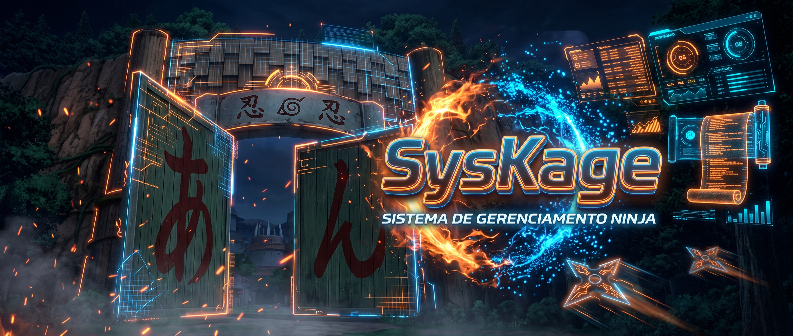

<h1 align="center">SysKage</h1>

## Sobre o projeto
SysKage é uma plataforma desenvolvida para a disciplina de Pesquisa e Inovação da SPTech. O sistema é voltado para o gerenciamento de aldeias ninjas e análise de desempenho das equipes, permitindo visualizar estatísticas, gerenciar missões e monitorar o desenvolvimento dos ninjas através de dashboards e gráficos.

## Funcionalidades
- Cadastro e login de usuários
- Gerenciamento de aldeias e registro de ninjas
- Formação de times (compostos obrigatoriamente por 3 ninjas de nível Genin e 1 ninja líder de nível Jounin)
- Sistema e registro de missões com diferentes níveis de dificuldade (Ranks D, C, B, A e S)
- Validação de missões: equipes só podem aceitar missões se atingirem um nível mínimo de poder de combate ou se tiverem a classificação correspondente
- Visualização de estatísticas
- Dashboards com gráficos interativos

## Tecnologias utilizadas
- HTML
- CSS
- JavaScript
- Node.js
- MySQL
- Chart.js

## Banco de dados
O sistema utiliza um banco de dados relacional para armazenar:
- Usuários
- Aldeias
- Ninjas (com atributos como nível, classificação e poder de combate)
- Times
- Missões (com requisitos de dificuldade e poder)
- Estatísticas

## Objetivo
O projeto tem como objetivo organizar e apresentar dados de aldeias, times e missões ninjas de forma visual e intuitiva, auxiliando no acompanhamento do desempenho e na tomada de decisões estratégicas no mundo ninja, além de aplicar na prática os conceitos de pesquisa e desenvolvimento propostos pela SPTech.